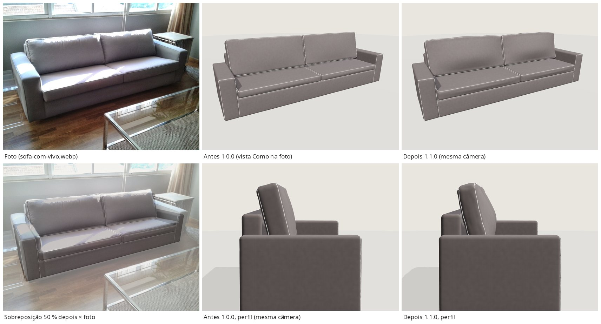
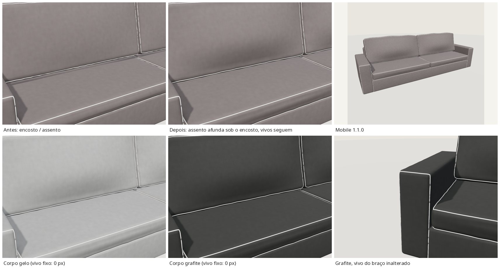

# Correção de almofadas — 2026-10 (EXT-005; EXT-001/EXT-003 avaliados)

Estado: **tecnicamente validado – revisão visual pendente**. Só EXT-005 mudou.

## EXT-005 `stanza-piped-01` 1.0.0 → 1.1.0

Problema: as almofadas próprias do sofá (2 de assento + 2 de encosto) pareciam placas finas,
planas e rígidas. Em `acervo/sofa-com-vivo.webp` elas são cheias: assentos grossos com topo
abaulado e frente arredondada; encostos grandes e fofos com topo arredondado/levemente ondulado,
apoiados no assento e no painel.

O que mudou (`source/build.py`; a biblioteca `lib/stanza3d.py` **não** foi alterada):

| | 1.0.0 | 1.1.0 |
|---|---|---|
| Espessura do assento | 0,13 m (base 0,32) | 0,165 m (base 0,285; altura de assento mantida 0,45). Na foto a frente da almofada mede ~0,6× a faixa visível da base |
| Topo / frente do assento | coroas 16/16 mm | topo abaulado 30 mm + rolo frontal 16 mm, cantos r 45 mm |
| Encosto (caixa) | h 0,64 · t 0,20 · coroa frontal 30 mm · inclinação 14° | h 0,66 · t 0,17 + ~8 cm de coroas (barriga frontal 65 mm, costas 16 mm) · 15° · topo com cantos caídos 30 mm, ondulação 6 mm, leve tombamento para a frente 18 mm |
| Contato | `rest_rigid` (3 mm, rígido) | `rest_rigid` (18 mm no assento, 7 mm no painel) **seguido de compressão local** (`settle_contacts`): o assento afunda ~11 mm sob a base do encosto, o encosto achata ~7–10 mm sobre o assento afundado e na frente do painel |
| Vivos | `seam_loop` da caixa rígida | o mesmo traçado, levado pela deformação e re-encaixado na capa deformada (lift 1,2 mm) |

Também: as dobras finas (`wrinkle`) são recalculadas de forma contínua no `SoftBox` local — a da
biblioteca troca de eixos na linha de 45° e, com malha densa, criava vincos de até 106°; agora o
vinco máximo das almofadas é 22–32°, igual ao das peças de estrutura. Continua: 2 assentos + 2
encostos na região `body`; `piping_light` fixo; sem almofadas decorativas.

Números (contacts.py, mm; [validação](validation/cushfix/ext005/)):

| Par | antes 1.0.0 | depois main | depois mobile |
|---|---|---|---|
| encosto → assento | 2,96 (16 vért.) | 3,01 (202 vért.: apoio em área, não em aresta) | 3,00 |
| assento → encosto (afundamento compartilhado) | 0,08 | 3,00 | 2,47 |
| encosto → painel | 3,00 | 3,83 | 4,62 |
| encosto ↔ encosto, assento ↔ assento, ↔ braços | 0 | 0 (folgas 2,0 / 0,24 / ≥ 2,3) | 0 |
| assento → faixa da base | 1,5 | 1,78 | 2,5 |
| vivo → outra peça | 0 | 0 | 0 |
| vivo na própria capa | — | 2,0 (embutido, sem flutuar) | — |

- glTF-Validator: 0 erros / 0 avisos / 0 infos / 0 hints nos dois GLBs.
- `behaviour.mjs stanza-piped-01`: 76/76.
- Máscara: com corpo gelo e grafite o vivo varia 0 px (close do contato e vivo do braço); retorno
  ao inicial 0 px; mobile idem.
- Principal 67 752 tri / 3,58 MB (antes 49 896 / 3,01 MB); móvel 29 232 tri / 1,21 MB (antes 22 120 / 0,98 MB).
- sha256: principal `88d9f52c9211…`, móvel `8c91c1620716…`. Pôster regenerado pelo visualizador real.

Diferenças que restam: na foto os encostos parecem ainda mais altos e fofos no centro, com
rugas maiores; aqui o volume vem de forma paramétrica, sem rugas de tecido reais. No perfil
aparece um pequeno bico no canto superior traseiro, onde o vivo de trás contorna o canto.
O afundamento do assento quase não aparece na vista da foto (aparece no close). A malha do
mobile é mais grosseira e quase não afunda o assento (0–1 mm; o achatamento do encosto existe).

## EXT-001 `stanza-organic-01` 2.1.0 — sem mudança

Nenhuma almofada flutua, atravessa outra peça ou fica fina: em `validation/ext001-r2/cushion-fit-main.json`
a penetração máxima entre almofadas é 1,6 mm, com áreas de contato de 68–159 cm² (apoio em área, não
em ponto). As almofadas claras inclinadas, com cantos em ponta, seguem a
foto: em `SOFA-2.jpg` elas também estão giradas com um canto para baixo. A diferença que se vê é de
pose: na foto elas reclinam e cedem mais na base. Testei girar e inclinar mais as três claras e
recalcular a pilha. O meu cálculo de apoio **não reproduz** as poses resolvidas da 2.1.0 (com as
rotações originais a `cushion_03` cai 20 cm à frente), então qualquer pose nova seria chute sem
validação. Revertido; nada foi commitado. Para ajustar a pose é preciso reconstruir aquele cálculo
de apoio primeiro.

## EXT-003 `stanza-modular-01` 1.0.0 — sem mudança

As almofadas estão apoiadas e se sobrepõem como na foto. Os contatos da 1.0.0 são todos ≤ 3,7 mm,
exceto um único vértice do canto do assento 2 que fica 6,4 mm dentro da almofada 4, onde ela
contorna a quina assento/encosto. Isso não aparece em nenhuma vista. Na foto as almofadas grandes
são um pouco maiores e se sobrepõem mais, mas isso é composição, não defeito; mudar isso seria
remodelar.

EXT-002 e EXT-004 não foram tocados (não mostram o mesmo problema).
