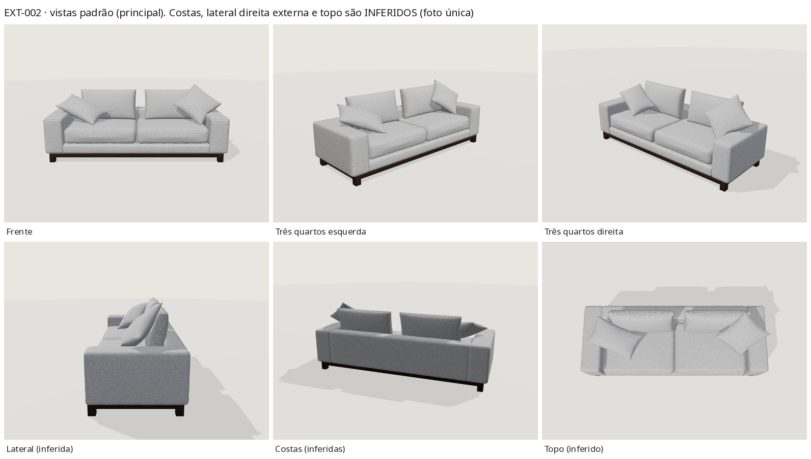
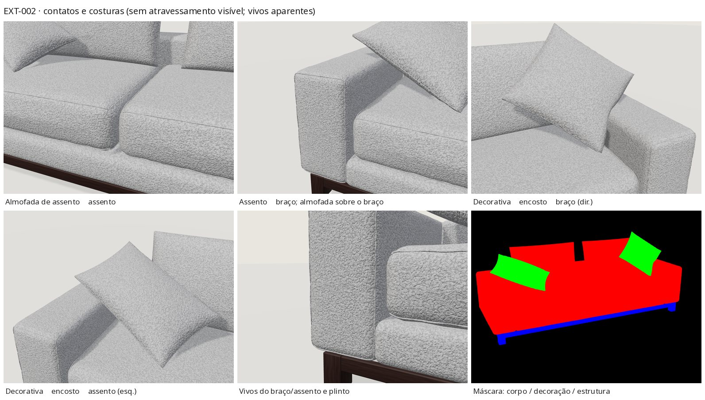

# EXT-002 — Sofá cinza de linhas retas (`stanza-straight-01`, revisão 1.0.0)

Estado: **tecnicamente validado – revisão visual pendente**. Somente exterior. Estudo visual com
medidas estimadas a partir de uma única foto; não é desenho de fabricação.

- Prévia: `/explorar-sofa.html?modelo=stanza-straight-01` · página do produto com "Ver em 3D":
  `/modelos/sofa-reto.html` (deploy preview do PR #1).
- Fonte: [`assets/models-3d/stanza-straight-01/source/build.py`](../../assets/models-3d/stanza-straight-01/source/build.py)
  (usa a biblioteca compartilhada [`assets/models-3d/lib/stanza3d.py`](../../assets/models-3d/lib/stanza3d.py)).
  Pipeline: [models3d-pipeline.md](models3d-pipeline.md).

## 1. Referência e relação com o acervo

| | |
|---|---|
| Foto | [`sofas/SOFA-5.jpg`](../../sofas/SOFA-5.jpg) (1280×960, frente-esquerda, câmera elevada, vista única) |
| Catálogo | `sofa-reto` — "Sofá de linhas retas" (`data/catalog.json`) |
| Portfólio | `projeto-5` — "Sofá cinza de linhas retas" (`data/portfolio.json`) |
| Duplicatas | Nenhuma: só esses dois itens usam `SOFA-5.jpg`; IDs existentes preservados. O teste de registro confere que a foto do modelo é a mesma das duas entradas. |

Leitura da foto: sofá de dois lugares de linhas retas em bouclé cinza claro mesclado (laços brancos
e cinza); braços largos e quadrados, de topo plano, na mesma altura de um encosto baixo; base
estofada contínua (faixa frontal) sob duas almofadas de assento caixa; duas almofadas soltas de
encosto (ligeiramente deslocadas para a direita, deixando o painel do encosto à mostra junto ao
braço esquerdo); duas almofadas decorativas do mesmo bouclé — uma retangular deitada na diagonal
sobre o canto esquerdo, outra quadrada em losango apoiada no canto direito; plinto de madeira
escura (faixa fina + pés-bloco quadrados nos cantos, recuado em relação ao estofado).

## 2. Regiões de material

| Malhas | Material | Região |
|---|---|---|
| `arm_l`, `arm_r`, `base_band`, `back_panel`, `seat_cushion_1/2`, `back_cushion_1/2_cover` | `fabric_main` | corpo personalizável (`body`) |
| vivos `*_welt` dos braços, assentos e encostos | `fabric_seam` | corpo personalizável (`body`) |
| `pillow_1_cover`, `pillow_2_cover` | `pillow_boucle` | decoração fixa (`decorative`) |
| `pillow_1_welt`, `pillow_2_welt` | `pillow_seam` | decoração fixa (`decorative`) |
| `plinth_apron_*`, `foot_1..4` | `plinth_wood` | estrutura externa aparente (`exterior-structure`) |
| — | — | contrastes fixos: nenhum visível (sem vivos de outra cor, tachas ou botões) |

As almofadas de assento e encosto são funcionais e do tecido do corpo → `body`. As decorativas
começam com o mesmo bouclé (fator de cor 0,93, um pouco mais cinza como na foto) mas são **fixas**.

## 3. Componentes e construção (exterior)

Grupos `upholstery` (corpo), `cushions` (decorativas), `legs` (plinto); raiz `model_root` com
extras `modelId`, `revision`, `construction:"exterior-only"`, `materialRegions`, `embeddedFinish`.

- **Corpo:** caixas estofadas `RoundedBox` (raio 3,5 cm nos braços/encosto, 3 cm na base), com
  coroas suaves por face e rugas rasas perto das arestas; vivo no painel frontal de cada braço. As
  junções braço/base/encosto são volumes sobrepostos ocultos que leem como vinco costurado (não há
  armação interna).
- **Assentos:** duas almofadas caixa (raio 5,5 cm, coroa 2,2 cm no topo e 1,4 cm na frente), vivos no
  topo e na base, folga de 6 mm entre si.
- **Encostos:** almofadas soltas de borda faca com enchimento arredondado (`pillow_shape(edge_round)`),
  inclinadas 12°, posicionadas por `solve_rest()` (descem até o assento, recuam até o painel) e
  acomodadas por `settle_contacts()`; depois re-acomodadas em torno das decorativas (contato mútuo).
- **Decorativas:** borda faca com cantos em ponta e rugas (porte do EXT-001); posições resolvidas
  na variante principal e **reutilizadas** na móvel (mesma composição).
- **Plinto:** faixa de 4,8 cm e pés-bloco de 6,8 cm, madeira escura (`wood-wenge`, veio longo).

## 4. Proporções (estimativas)

Câmera e proporções ajustadas por mínimos quadrados a 16 pontos marcados na foto (rms ≈ 11 px em
1280×960), com a altura do assento **fixada em 0,44 m** (premissa). Resultado:

| Medida | Valor | Observação |
|---|---|---|
| Largura total | 2,33 m | ajustada |
| Profundidade | 0,86 m (0,87 com almofadas) | fraca: pontos traseiros indicam 0,75–0,95 m |
| Altura dos braços / encosto | 0,575 m | ajustada |
| Largura do braço | 0,24 m | ajustada |
| Plinto (topo) / faixa / pé | 0,115 / 0,048 / 0,068 m | ajustados |
| Base estofada (topo) | 0,24 m | ajustada |
| Almofada de assento | 0,20 m de espessura | resulta do assento 0,44 |
| Almofada de encosto | 0,78 × 0,43 m | iterada contra a foto |
| Decorativas | 0,60 × 0,35 m e 0,47 × 0,47 m | iteradas contra a foto |
| Altura máxima | 0,988 m | canto da decorativa direita |

## 5. Opções expostas (implementadas)

Acabamento inicial (embutido no GLB): **bouclé mescla · cinza gelo** (`boucle-mescla` / `gelo`).
Os dois IDs são **novos e aditivos**: nenhuma cor existente representava o cinza frio da foto
(`areia` é bege quente; medido na foto R≈G≤B) e o bouclé fino existente não tem o mesclado
branco/cinza. IDs antigos inalterados.

- Tecidos: `boucle-mescla` (novo, biblioteca `assets/models-3d/materials/boucle-mescla/`), `boucle`,
  `linen`, `velvet` (reutilizados de `assets/sofa-pilot/materials/` por referência).
- Cores: `gelo` (inicial, `#babcc0`), `areia`, `grafite`, `oliva`, `terracota`.
- Só o corpo muda; decorativas e plinto fixos. Orçamento:
  `/orcamento.html?referencia=sofa-reto&estudo=stanza-straight-01&tecido=…&cor=…` (o formulário e o
  redirecionamento seguro reconhecem o estudo via `studies` em `data/sofa-pilot.json`).

## 6. Medidas, orçamento e integridade

| Variante | Triângulos | Bytes | Limite | sha256 |
|---|---|---|---|---|
| principal | 49 384 | 4 154 200 | ≤ 60k / ≤ 5 MB | `2b11e9410a2da464887733c66b75e7ddb2f3c322e26e17a730f72f562b5b6ce7` |
| móvel | 21 996 | 1 220 660 | ≤ 25k | `9274cf995d3e6edf1bcacbe3c9c867b2a58b7286ce6b0a1861ecc0b400fba244` |

Mapas embutidos (principal): bouclé mescla gelo 1024 (base) + normal 1024 + rugosidade 256; madeira
512/256/256. Móvel: 512/256/256 e madeira 256. Mapas externos (1024) só ao escolher outro tecido.
Poster: `previews/poster.jpg` (1200×900, render do visualizador real, 96 KB).

## 7. Validação (build congelado)

Todas as capturas vêm do **visualizador real** (`createSofaViewer`) servido do `dist/` construído,
Chrome for Testing headless (SwiftShader). Arquivos em [`validation/ext002/`](validation/ext002/).

| Verificação | Resultado |
|---|---|
| glTF-Validator 2.0.0-dev.3.10 (principal e móvel) | 0 erros, 0 avisos, 0 infos, 0 dicas |
| `npm test` | 35/35 (inclui `tests/models3d-registry.test.mjs`, 9 testes novos) |
| `build.py --production` + `check_site.py --production` | OK (valida GLB, sha256, revisão, opções, entrada "Ver em 3D") |
| Comportamento (`scripts/models3d/behaviour.mjs`) | **73/73**: EXT-002 e regressão EXT-001, principal e móvel — poster/opções/orçamento antes do clique, nenhum GLB antes da intenção, só o GLB do modelo depois, troca pela UI, troca rápida (última vence), falha de textura + nova tentativa, volta ao inicial idêntica em pixels, decorativas/estrutura intocadas, opção não exposta rejeitada, resize, dispose idempotente, 0 erros de console (além do 1 aborto intencional), páginas de produto, modelo desconhecido, home sem a coleção |
| Máscara de pixels (cores do corpo) | decorativas e plinto: diferença **0** em todas as 8 trocas (principal) e 2 (móvel); volta ao inicial: corpo com diferença 0 |
| Contatos (`scripts/models3d/contacts.py`) | contatos macios ≤ 2,4 mm (principal) / ≤ 5,1 mm (móvel, sob a decorativa esquerda); plinto↔corpo ≤ 1,4 mm; junções ocultas do corpo até 50 mm (intencionais) |
| Regressão EXT-001 | 12 capturas antes (HEAD e947706) × depois: **0 pixels diferentes** |

## 8. Avaliação visual honesta

Pontos fortes: a silhueta e a composição batem com a foto na sobreposição (braços quadrados na
altura do encosto, base estofada, plinto escuro recuado com pés-bloco, assentos caixa com coroa,
encostos deslocados, decorativas na diagonal e em losango); o bouclé mescla lê como laços
cinza/brancos à distância e de perto; as trocas de cor afetam só o corpo.

Diferenças restantes: as decorativas da foto são mais cheias e caídas (a da esquerda repousa mais
sobre o braço); os encostos da foto são um pouco mais abaulados; a luz do visualizador (de cima, fixa)
clareia as faces verticais mais que a foto de oficina; o bouclé real tem laços maiores e mais
irregulares em close; costas, topo e lateral direita externa são inferidos.

## 9. Limitações

- Uma única foto; profundidade, costas e fundo do plinto inferidos. Medidas estimadas (assento fixado em 0,44 m).
- Tecido e cor iniciais são estimativas visuais; não há amostra medida.
- Junções do corpo por volumes sobrepostos (ocultos); não é modelo de fabricação.
- Contato móvel até 5,1 mm (vértice do assento sob a decorativa esquerda; oculto).
- Validação apenas headless (SwiftShader); sem teste em aparelho físico; sem revisão da Stanza ainda.

## 10. Índice de imagens

| Imagem | Conteúdo |
|---|---|
| [ext002_photo_vs_render.jpg](images/ext002_photo_vs_render.jpg) | foto × render no ângulo da foto × sobreposição × preset `photo` |
| [ext002_views.jpg](images/ext002_views.jpg) | frente, 3/4 esquerda e direita, lateral, costas e topo (inferidos) |
| [ext002_closeups.jpg](images/ext002_closeups.jpg) | contatos assento↔assento, assento↔braço, decorativas↔encosto↔braço, vivos e plinto, máscara de regiões |
| [ext002_body_colours.jpg](images/ext002_body_colours.jpg) | cores do corpo (gelo, areia, grafite, oliva, terracota, volta ao inicial) com decoração fixa |
| [ext002_fabrics.jpg](images/ext002_fabrics.jpg) | trama plana, veludo, bouclé e retorno ao bouclé mescla |
| [ext002_mobile.jpg](images/ext002_mobile.jpg) | variante móvel |
| [ext002_ext001_regression.jpg](images/ext002_ext001_regression.jpg) | EXT-001 antes × depois do visualizador generalizado |
| [ext002_configurator.jpg](images/ext002_configurator.jpg) | configurador (desktop e 390 px) e página do produto com "Ver em 3D" |

