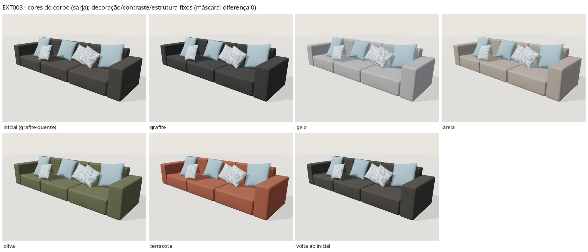

# EXT-003 — Sofá modular cinza (`stanza-modular-01`, revisão 1.0.0)

Estado: **tecnicamente validado – revisão visual pendente**. Somente exterior. Estudo visual com
medidas estimadas a partir de uma única foto; não é desenho de fabricação.

- Prévia: `/explorar-sofa.html?modelo=stanza-modular-01` · produto com "Ver em 3D": `/modelos/sofa-modular.html`.
- Fonte: [`assets/models-3d/stanza-modular-01/source/build.py`](../../assets/models-3d/stanza-modular-01/source/build.py)
  (biblioteca [`stanza3d.py`](../../assets/models-3d/lib/stanza3d.py)); pipeline: [models3d-pipeline.md](models3d-pipeline.md).

## 1. Referência e relação com o acervo

| | |
|---|---|
| Foto | [`sofas/SOFA-3.jpg`](../../sofas/SOFA-3.jpg) (1280×960, frente-**direita**, câmera elevada, vista única; a peça recua do braço direito, próximo, para o esquerdo) |
| Catálogo | `sofa-modular` — "Sofá modular" |
| Portfólio | `projeto-3` — "Sofá modular cinza" |
| Duplicatas | Nenhuma: só esses dois itens usam `SOFA-3.jpg`; nenhuma outra foto mostra a peça. IDs preservados. |

Leitura da foto: sofá **modular de blocos** apoiado direto no tapete; dois braços-bloco altos e
quadrados; três blocos de assento largos e monolíticos (sem almofada solta), cada um um módulo
separado com junta visível; atrás, três blocos de encosto — mais altos que os braços (aparecem acima
do braço direito) — com juntas alinhadas às dos assentos. Tecido liso, fosco, de trama fechada,
cinza-escuro levemente quente. Sete almofadas decorativas apoiadas no encosto: quatro lisas
azul-acinzentado (três grandes, uma menor) e três estampadas com losangos concêntricos azul/cinza
sobre branco.

## 2. Regiões de material

| Malhas | Material | Região |
|---|---|---|
| `arm_l`, `arm_r`, `seat_block_1..3`, `back_block_1..3` | `fabric_main` | corpo personalizável (`body`) |
| `pillow_1/2/4/7_cover` · `_welt` | `pillow_blue` · `pillow_blue_seam` | decoração fixa |
| `pillow_3/5/6_cover` · `_welt` | `pillow_print` · `pillow_print_seam` | decoração fixa |
| — | — | contrastes fixos: nenhum (sem vivos, tachas, botões) |
| — | — | estrutura externa aparente: **nenhuma visível** (blocos no piso; nada inventado) |

Não há almofadas funcionais soltas: os próprios blocos são o corpo. Sem costuras/vivos visíveis nos
módulos, por isso o corpo tem só `fabric_main` (o registro declara exatamente esse conjunto).

## 3. Componentes (exterior)

- **Braços** (2) e **blocos de encosto** (3): `RoundedBox` (raio 4 cm, coroas suaves por face).
- **Blocos de assento** (3): `RoundedBox` raio 5 cm, coroa de 12 mm no topo e 8 mm na frente, rugas rasas.
- **Juntas**: 4 mm entre módulos vizinhos (lidas como fenda costurada; coroas laterais limitadas para não atravessar).
- **Almofadas** (7): borda faca (`LooseCushion`): camada 0 (três grandes, 0,66 m) desce até o assento e recua até o encosto; camada 1 (quatro menores, ~0,50 m) recua até o encosto/almofadas já colocadas; depois as grandes são re-acomodadas em torno das menores (contato mútuo). Posições resolvidas na principal e reutilizadas na móvel.

## 4. Proporções (estimativas)

Câmera + proporções por mínimos quadrados a 17 pontos marcados (rms ≈ 12 px com rolagem livre),
**assento fixado em 0,40 m**. As juntas dos encostos, não usadas no ajuste, caem a ≤ 9 px do previsto
(boa consistência). O preset `photo` foi reajustado com rolagem 0 (rms 16 px), porque o visualizador
não reproduz os ~3° de rolagem da foto.

| Medida | Valor | Observação |
|---|---|---|
| Largura total | 4,24 m | ajustada (módulos de 1,18 m) |
| Profundidade | 1,17 m | ajustada |
| Braço: altura / largura | 0,76 / 0,34 m | ajustadas |
| Encosto: altura / espessura | 0,96 / 0,22 m | altura ajustada; espessura **assumida** (invisível) |
| Bloco de assento | 0,40 m (premissa) × 0,95 m de fundo | |
| Almofadas | 0,66 m (grandes), ~0,50 m (menores) | iteradas contra a foto |
| Altura máxima | 1,13 m | ponta da almofada grande direita |

## 5. Opções (implementadas)

Inicial embutido: **sarja · grafite quente** (`sarja` / `grafite-quente` `#545050`), IDs **novos e
aditivos**: nenhuma família existente é uma trama plana fosca e fechada (o `linen` tem relevo de fio
aberto) e `grafite` (`#494b4b`) é neutro/escuro demais diante da foto. Tecidos: `sarja`, `linen`,
`boucle`, `velvet`. Cores: `grafite-quente`, `grafite`, `gelo`, `areia`, `oliva`, `terracota`.
Só o corpo muda; as almofadas ficam fixas. Orçamento:
`/orcamento.html?referencia=sofa-modular&estudo=stanza-modular-01&tecido=…&cor=…`.

Biblioteca: [`sarja`](../../assets/models-3d/materials/sarja/) (sarja 2/2, 256 fios por 0,30 m, CC0
procedural) e [`decor-losango`](../../assets/models-3d/materials/decor-losango/) (estampa decorativa
procedural; não é a foto). As almofadas lisas usam só fator de cor sobre o relevo da sarja (sem imagem extra).

## 6. Medidas e integridade

| Variante | Triângulos | Bytes | Limite | sha256 |
|---|---|---|---|---|
| principal | 51 448 | 3 165 244 | ≤ 60k / ≤ 5 MB | `d8973c7cb96b9a11683621f4091fd96be705cd314e3e7b5a2e750fb6cc359b43` |
| móvel | 24 092 | 1 107 144 | ≤ 25k | `11bb4d078af0297f20f1568a1e77d564bb5f920019fab267a5e692b8ec22d3fa` |

## 7. Validação (build congelado) — [`validation/ext003/`](validation/ext003/)

| Verificação | Resultado |
|---|---|
| glTF-Validator (principal e móvel) | 0 erros / 0 avisos / 0 infos / 0 dicas |
| `behaviour.mjs stanza-modular-01` | **74/74** (EXT-003 + regressão EXT-001; principal/móvel, troca rápida, falha+retentativa, volta ao inicial idêntica, resize, dispose, console 0, páginas de produto) |
| Máscara de pixels | almofadas: diferença **0** em todas as trocas (5 cores + 3 tecidos, principal; 2, móvel); volta ao inicial: corpo 0 |
| Contatos (`contacts-summary.json`) | corpo↔corpo ≤ 0,5 mm; almofada→corpo/almofada ≤ 1,3 mm (compressão macia); 1 vértice de canto do assento 6,4 mm dentro da almofada 4 (principal; 4,7 mm na móvel) — oculto sob a almofada; vivos das almofadas até 3,7 mm afundados no próprio enchimento onde a almofada está comprimida |

## 8. Avaliação honesta

Fortes: silhueta e módulos batem na sobreposição (braços altos, encosto acima dos braços, três
blocos com juntas nos lugares certos, apoio direto no piso); a composição das sete almofadas
(lisas/estampadas, grandes atrás, menores na frente, losango à direita) lê como a foto; o tecido
liso fosco e o cinza quente são próximos.
Diferenças: a foto tem luz de janela por trás que clareia os topos (o visualizador usa luz fixa,
então os topos ficam mais escuros que na foto); as almofadas reais são mais moles e se sobrepõem
mais; a estampa é uma releitura; a rolagem de 3° da câmera não é reproduzida.

## 9. Limitações

Vista única (costas, lateral esquerda externa e fundo inferidos); escala por premissa (assento
0,40 m); espessura do encosto assumida; tecido/cor estimados visualmente; se houver pés ocultos,
não foram modelados; validação só headless (SwiftShader); sem revisão da Stanza.

## 10. Imagens

| Imagem | Conteúdo |
|---|---|
| [ext003_photo_vs_render.jpg](images/ext003_photo_vs_render.jpg) | foto × render no ângulo da foto × sobreposição 50 % × máscara de regiões |
| [ext003_views.jpg](images/ext003_views.jpg) | frente, 3/4 esquerda/direita, lateral, costas (inferidas) |
| [ext003_closeups.jpg](images/ext003_closeups.jpg) | junta assento↔assento, assento↔braço, almofadas, junta dos encostos, apoio no piso |
| [ext003_body_colours.jpg](images/ext003_body_colours.jpg) | cores do corpo (inclui gelo claro e grafite escuro) com almofadas fixas |
| [ext003_fabrics.jpg](images/ext003_fabrics.jpg) | troca de tecido e volta ao inicial |
| [ext003_mobile.jpg](images/ext003_mobile.jpg) | variante móvel |

