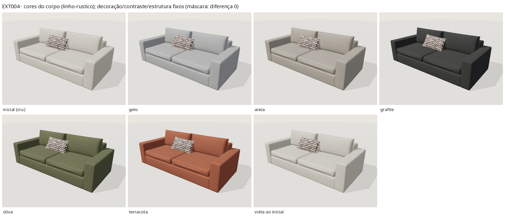

# EXT-004 — Sofá claro de dois assentos (`stanza-two-seat-01`, revisão 1.0.0)

Estado: **tecnicamente validado – revisão visual pendente**. Somente exterior; medidas estimadas a
partir de uma única foto; não é desenho de fabricação.

- Prévia: `/explorar-sofa.html?modelo=stanza-two-seat-01` · produto com "Ver em 3D": `/modelos/sofa-dois-assentos.html`.
- Fonte: [`assets/models-3d/stanza-two-seat-01/source/build.py`](../../assets/models-3d/stanza-two-seat-01/source/build.py) (biblioteca [`stanza3d.py`](../../assets/models-3d/lib/stanza3d.py)).

## 1. Referência e relação com o acervo

| | |
|---|---|
| Foto | [`acervo/sofa-dois-assentos.webp`](../../acervo/sofa-dois-assentos.webp) (2560×1920; ajuste feito na redução 1280×960), frente-**direita**, câmera elevada, vista única |
| Catálogo | `sofa-dois-assentos` — "Sofá de dois assentos" |
| Portfólio | `projeto-47` — "Sofá claro de dois assentos" |
| Duplicatas | Nenhuma: a mesma foto também ilustra a página "Sobre" (`ABOUT_IMAGE` em `scripts/build.py`), mas é a mesma peça — nenhuma entrada nova. IDs preservados. |

Leitura da foto: dois lugares fundo, estofado até o tapete (sem pés visíveis); braços retos e
quadrados **mais baixos que o encosto**; base estofada contínua sob duas almofadas de assento caixa
espessas (a frente abaula um pouco além do braço); painel de encosto visível acima do braço
direito; duas almofadas soltas de encosto altas, de enchimento arredondado; tecido claro off-white de
aspecto linho com leve flamê; uma almofada lombar com retângulos bege em fundo marrom-escuro.

## 2. Regiões de material

| Malhas | Material | Região |
|---|---|---|
| `arm_l/r`, `base_band`, `back_panel`, `seat_cushion_1/2`, `back_cushion_1/2_cover` e `_welt` | `fabric_main` | corpo personalizável |
| `pillow_1_cover` / `pillow_1_welt` | `pillow_squares` / `pillow_squares_seam` | decoração fixa |
| — | — | contrastes fixos: nenhum (as costuras são do mesmo tecido e seguem o corpo) |
| — | — | estrutura externa aparente: nenhuma visível (nada inventado) |

## 3. Componentes

Braços `RoundedBox` (raio 3,2 cm); base estofada (topo 0,28 m) que se estende oculta 5 cm sob o painel;
painel do encosto (0,78 m); duas almofadas de assento caixa (raio 5,5 cm, coroa 2 cm no topo e 2,4 cm
na frente, folga 6 mm); duas almofadas de encosto soltas (`pillow_shape(edge_round=.6)`, inclinação
10°, `solve_rest` + `settle_contacts`, re-acomodadas em torno da lombar); almofada lombar de borda
faca apoiada no assento e nas duas almofadas de encosto (atravessa a junta, como na foto). Posições
resolvidas na principal e reutilizadas na móvel.

## 4. Proporções (estimativas)

Ajuste câmera+proporções a 12 pontos (rms ≈ 9 px), **assento fixado em 0,45 m**:
largura 2,63 m · profundidade 1,20 m (um único ponto traseiro: fraca) · braço 0,65 × 0,23 m ·
almofada de assento 0,17 m · base 0,28 m · encosto 0,78 m (lido acima do braço) · almofadas de encosto
1,05 × 0,49 m · lombar 0,68 × 0,38 m · altura máxima 0,95 m.

## 5. Opções

Inicial embutido: **linho rústico · cru** (`linho-rustico` / `cru` `#e2ddd2`), IDs **novos e
aditivos** (a trama plana existente é regular, sem flamê; `gelo` é frio e `areia` escuro demais).
Tecidos: `linho-rustico`, `linen`, `boucle`, `velvet`. Cores: `cru`, `gelo`, `areia`, `grafite`,
`oliva`, `terracota`. Só o corpo muda. Orçamento: `referencia=sofa-dois-assentos&estudo=stanza-two-seat-01`.
Biblioteca: [`linho-rustico`](../../assets/models-3d/materials/linho-rustico/) (tela simples 256 fios/0,30 m
com flamê, CC0 procedural) e [`decor-quadrados`](../../assets/models-3d/materials/decor-quadrados/) (desenho decorativo procedural).

## 6. Medidas e integridade

| Variante | Triângulos | Bytes | sha256 |
|---|---|---|---|
| principal | 39 188 | 3 716 244 | `15eb056ab5cbac90abe5fd87c564af3a8befd30437f84b330998435c5a863f45` |
| móvel | 15 976 | 951 352 | `7e1e39fb3423bc632d5f7b4f8c6f838cc73153fd01e4fc7867d0414399994267` |

## 7. Validação — [`validation/ext004/`](validation/ext004/)

| Verificação | Resultado |
|---|---|
| glTF-Validator | 0/0/0/0 (principal e móvel) |
| `behaviour.mjs stanza-two-seat-01` | **75/75** (inclui regressão EXT-001) |
| Máscara de pixels | lombar: diferença **0** em 5 cores + 3 tecidos (principal) e 2 cores (móvel); volta ao inicial: corpo 0 |
| Contatos | almofadas soltas ↔ corpo ≤ 2,2 mm (compressão macia); costura do encosto até 3,8 mm no próprio enchimento comprimido; junções do corpo por volumes sobrepostos ocultos (braço↔base/encosto ~16 mm, base sob o painel 50 mm, intencionais) |

## 8. Avaliação honesta

Fortes: proporções e silhueta batem na sobreposição (braços baixos e largos, encosto acima dos
braços, assentos espessos sobre base, sem pés); almofadas de encosto altas e arredondadas; a lombar
atravessa a junta das almofadas como na foto; o off-white quente e a tela fosca leem próximos.
Diferenças: a lombar real é mais mole e tem desenho mais miúdo/irregular; as almofadas de encosto
reais são ligeiramente mais cheias no topo; a luz da foto (janela azulada) não é reproduzida.

## 9. Limitações

Vista única (costas/lateral esquerda inferidas); escala por premissa; profundidade fraca; tecido/cor
estimados; junções do corpo por volumes ocultos; validação só headless; sem revisão da Stanza.

## 10. Imagens

| Imagem | Conteúdo |
|---|---|
| [ext004_photo_vs_render.jpg](images/ext004_photo_vs_render.jpg) | foto × render × sobreposição 50 % × máscara |
| [ext004_views.jpg](images/ext004_views.jpg) | frente, 3/4 esq./dir., lateral, costas (inferidas) |
| [ext004_closeups.jpg](images/ext004_closeups.jpg) | assento/assento, assento/braço, lombar/encosto, encosto acima do braço, base no piso |
| [ext004_body_colours.jpg](images/ext004_body_colours.jpg) | cores do corpo (gelo claro, grafite escuro…) com a lombar fixa |
| [ext004_fabrics.jpg](images/ext004_fabrics.jpg) | troca de tecido e volta ao inicial |
| [ext004_mobile.jpg](images/ext004_mobile.jpg) | variante móvel |

