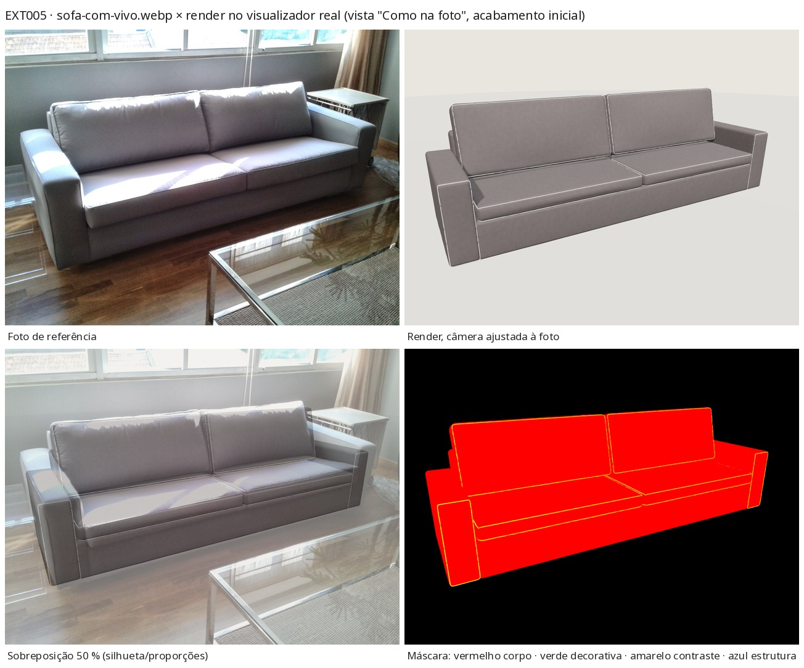
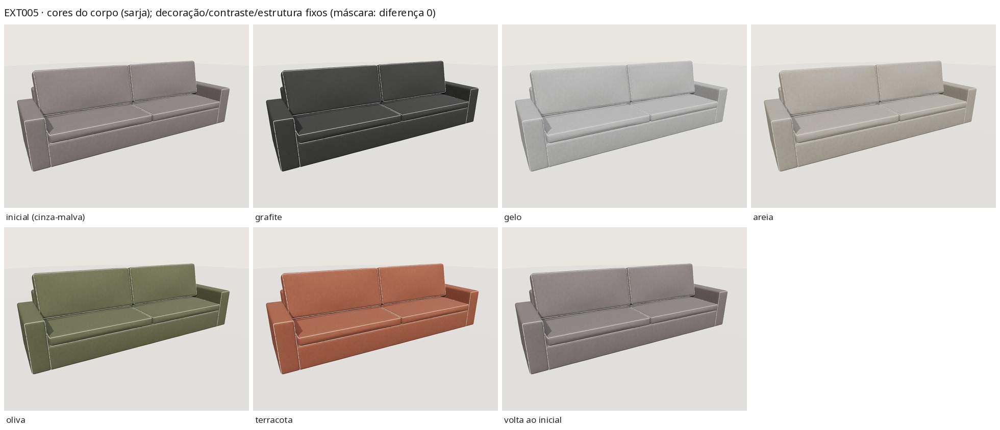

# EXT-005 — Sofá cinza com vivo claro (`stanza-piped-01`, revisão 1.0.0)

Estado: **tecnicamente validado – revisão visual pendente**. Somente exterior; medidas estimadas a
partir de uma única foto; não é desenho de fabricação.

- Prévia: `/explorar-sofa.html?modelo=stanza-piped-01` · produto com "Ver em 3D": `/modelos/sofa-com-vivo.html`.
- Fonte: [`assets/models-3d/stanza-piped-01/source/build.py`](../../assets/models-3d/stanza-piped-01/source/build.py) (biblioteca [`stanza3d.py`](../../assets/models-3d/lib/stanza3d.py): `oriented_box`, `rest_rigid` novos).

## 1. Referência e relação com o acervo

| | |
|---|---|
| Foto | [`acervo/sofa-com-vivo.webp`](../../acervo/sofa-com-vivo.webp) (2560×1920; ajuste na redução 1280×960), frente-**esquerda**, câmera elevada, lente grande-angular, ~2,6° de rolagem, sol forte de janela |
| Catálogo | `sofa-com-vivo` — "Sofá com vivo" |
| Portfólio | `projeto-48` — "Sofá cinza com vivo claro" |
| Duplicatas | Nenhuma: a mesma foto ilustra também a página de tecidos (`PIPING_IMAGE`) e um card da home (`projeto-48`), sempre a mesma peça. IDs preservados; a home continua sem o 3D da coleção (verificado). |

Leitura da foto: sofá longo de dois lugares em tecido liso cinza levemente malva; braços retos e
quadrados com **vivo claro** contornando o painel frontal; base estofada alta; duas almofadas de
assento caixa, finas e largas, com vivo claro no topo e na base; duas almofadas de encosto caixa
grandes, inclinadas, com vivo claro na face frontal e na traseira; nenhuma almofada decorativa;
braços e base chegam ao piso (nenhum pé confirmado — a faixa escura sob a peça é sombra).

## 2. Regiões de material

| Malhas | Material | Região |
|---|---|---|
| `arm_l/r`, `base_band`, `back_panel`, `seat_cushion_1/2`, `back_cushion_1/2_cover` | `fabric_main` | corpo personalizável |
| todos os `*_welt*` (painéis dos braços; assentos topo/base; encostos frente/costas) | `piping_light` (#e2e2e5) | **contraste fixo** |
| — | — | decoração fixa: nenhuma (sem almofadas decorativas) |
| — | — | estrutura externa aparente: nenhuma confirmada (nada inventado) |

O vivo é de outra cor, por isso não segue o corpo: fica claro em qualquer tecido/cor.

## 3. Componentes

Braços `RoundedBox` (raio 3 cm) + vivo no painel frontal (`seam_loop('-y')`, raio 3,2 mm); base
estofada (topo 0,32 m); painel do encosto (0,84 m, oculto); assentos caixa (0,13 m, avançam 2 cm sobre a
base, coroa 1,6 cm) com vivos topo e base; almofadas de encosto **caixa** (1,49 × 0,64 × 0,20 m,
inclinadas 14°) construídas no próprio referencial (`oriented_box`, nova na biblioteca) com vivos na
frente e nas costas, assentadas por contato rígido (`rest_rigid`, nova): descem até 3 mm no assento e
recuam até 3 mm no topo do painel.

## 4. Proporções (estimativas)

Ajuste a 8 pontos (rms ≈ 4 px com rolagem livre), **assento fixado em 0,45 m** e profundidade
**restrita a 1,0 m** (o fundo não é mensurável). Largura 3,46 m · braço 0,665 × 0,23 m · assento 0,13 m
· base 0,32 m · topo dos encostos ≈ 1,1 m (retroprojeção) · altura máxima 1,13 m. A frente do assento
no meio fica ~40 px acima de uma aresta reta (grande-angular e abaulado): o preset `photo`, com
rolagem 0, tem rms ≈ 20 px. É o item com proporções menos determinadas do lote.

## 5. Opções

Inicial embutido: **sarja · cinza malva** (`sarja` reutilizada do EXT-003 — tecido liso, fosco,
trama fechada; `cinza-malva` `#8a8286` cor **nova e aditiva**). Tecidos: `sarja`, `linen`, `velvet`,
`boucle`. Cores: `cinza-malva`, `grafite`, `gelo`, `areia`, `oliva`, `terracota`. O vivo não muda.
Orçamento: `referencia=sofa-com-vivo&estudo=stanza-piped-01`.

## 6. Medidas e integridade

| Variante | Triângulos | Bytes | sha256 |
|---|---|---|---|
| principal | 49 896 | 3 011 884 | `f4958e112278ca029c3218c269ed60fb22127c9bc3b1aaa4146a71338d1f4f74` |
| móvel | 22 120 | 983 004 | `e85352912d755bd7449b766827d1db49d2af38ef9b8331e461fbf67d329a4b90` |

## 7. Validação — [`validation/ext005/`](validation/ext005/)

| Verificação | Resultado |
|---|---|
| glTF-Validator | 0/0/0/0 (principal e móvel) |
| `behaviour.mjs stanza-piped-01` | **76/76** (inclui regressão EXT-001) |
| Máscara de pixels | **vivo (contraste): diferença 0** em 5 cores + 3 tecidos no close-up do braço (2 362 px de vivo após erosão; nas vistas inteiras o vivo tem 2 px e some na erosão); volta ao inicial: corpo 0 |
| Contatos | almofadas de encosto ↔ assento/painel ≤ 3,9 mm (principal) / 3,7 mm (móvel), sem folga; junções do corpo por volumes ocultos (base sob o painel 50 mm, intencional); vivos meio embutidos na própria capa (tubo centrado na costura) |

Na primeira versão o canto do painel entrava 15 mm na almofada de encosto da variante móvel (malha
grossa); a malha das almofadas de encosto foi adensada (4×10 segmentos) e o contato voltou a ≤ 3,7 mm.

## 8. Avaliação honesta

Fortes: o vivo claro desenha os mesmos contornos da foto (painéis dos braços, assentos, encostos) e
permanece fixo; encostos altos inclinados, assentos finos sobre base alta, braços baixos e quadrados
batem na sobreposição. Diferenças: a lente grande-angular da foto alarga o braço próximo e curva a
frente do assento, o que um preset de câmera sem distorção não reproduz; as almofadas de encosto reais
são mais moles (topo ondulado); o sol estoura os topos na foto; largura/profundidade são as mais incertas do lote.

## 9. Limitações

Vista única; escala por premissa e profundidade restrita; tecido/cor estimados; encostos rígidos com
coroa (sem caimento mole); sem pés confirmados; validação só headless; sem revisão da Stanza.

## 10. Imagens

| Imagem | Conteúdo |
|---|---|
| [ext005_photo_vs_render.jpg](images/ext005_photo_vs_render.jpg) | foto × render × sobreposição 50 % × máscara (amarelo = vivo) |
| [ext005_views.jpg](images/ext005_views.jpg) | frente, 3/4 esq./dir., lateral, costas (inferidas) |
| [ext005_closeups.jpg](images/ext005_closeups.jpg) | vivo do braço, assento/assento, assento/braço, encostos com vivo, base no piso |
| [ext005_body_colours.jpg](images/ext005_body_colours.jpg) | cores do corpo (gelo claro, grafite escuro…) com o vivo fixo |
| [ext005_fabrics.jpg](images/ext005_fabrics.jpg) | troca de tecido e volta ao inicial |
| [ext005_mobile.jpg](images/ext005_mobile.jpg) | variante móvel |

