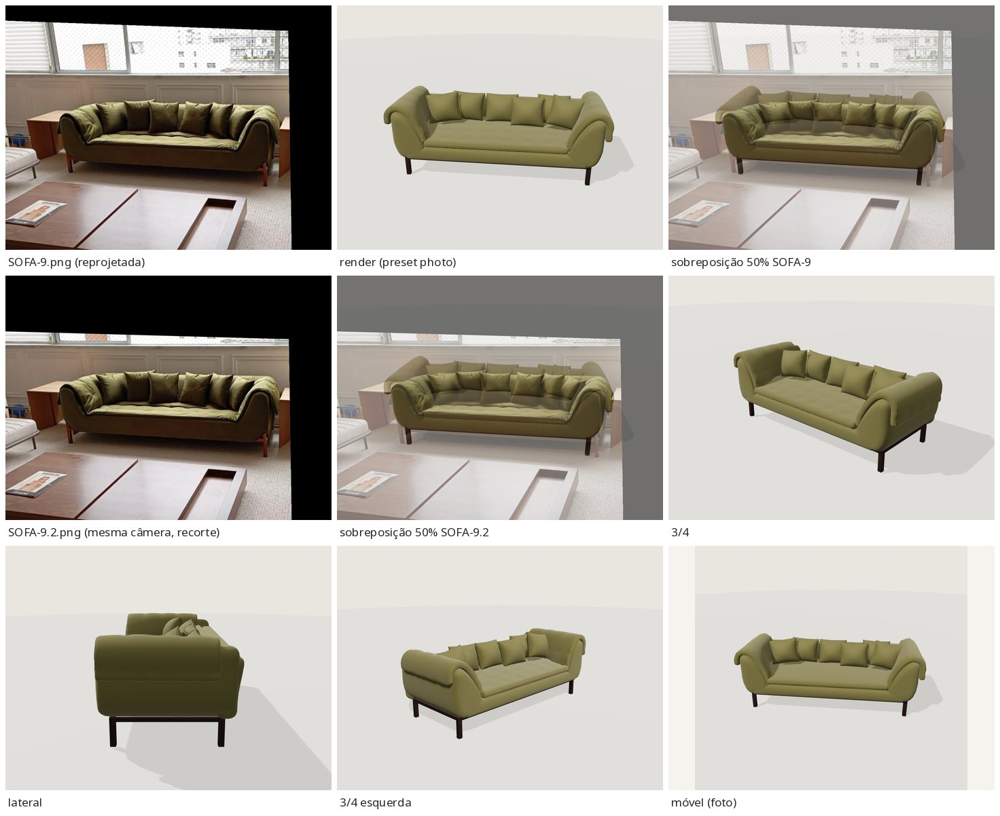
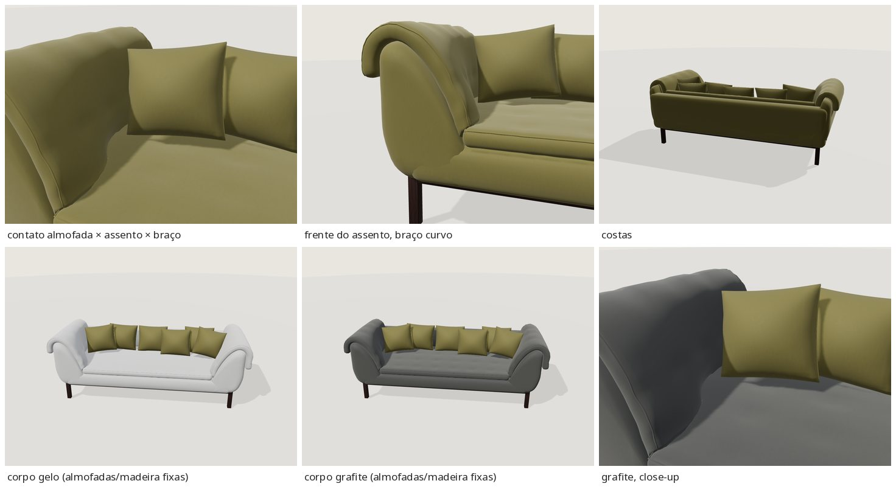

# EXT-007 — Sofá verde de braços curvos (`stanza-curved-arm-01` 1.0.0)

**Estado:** tecnicamente validado – revisão visual pendente · prévia `/explorar-sofa.html?modelo=stanza-curved-arm-01` · produto `/modelos/sofa-curvo.html` ("Ver em 3D").

## Relação

- Fotos: [`sofas/SOFA-9.png`](../../sofas/SOFA-9.png) (532×450) e [`sofas/SOFA-9.2.png`](../../sofas/SOFA-9.2.png) (532×332). Nenhuma das duas foi alterada.
- Catálogo `sofa-curvo` ("Sofá de braços curvos", `source` = SOFA-9, `gallery` = SOFA-9.2) e portfólio `projeto-9` ("Sofá verde de braços curvos", SOFA-9). Conferido em `data/catalog.json` e `data/portfolio.json`; nenhuma entrada nova.
- **As duas fotos são o mesmo ponto de vista.** SOFA-9.2 coincide com SOFA-9 recortada nas linhas 72–403 (diferença mediana de 2/255; só há retoques locais). Por isso as duas fotos não dão um segundo ângulo. A câmera foi ajustada uma vez e SOFA-9.2 foi conferida com a mesma câmera, recortada. Ela confirma as proporções e a composição, mas não ajuda a medir a profundidade.

## Regiões

| Região | Malhas / material | Por quê |
|---|---|---|
| corpo | `hull`, `arm_l/r`, `back_panel`, `seat_pad`, `back_pad`, `arm_pad_l/r` → `fabric_main`; pespontos `*_seam` → `fabric_seam` | Estofado principal e colchão matelassê funcional (assento, encosto, braços), no mesmo veludo |
| decoração fixa | `pillow_1..6_cover/welt` → `pillow_velvet`/`pillow_seam` | Seis almofadas soltas de 36 cm, apoiadas no encosto baixo. Pela regra da fila, almofadas soltas são decoração fixa, mesmo que comecem iguais ao corpo (o EXT-002 segue o mesmo princípio). Ficam no veludo musgo da foto |
| contraste fixo | — | Não há vivo, tacha nem botão de outra cor |
| estrutura aparente | `foot_1..4`, `wood_base_apron_*` → `base_wood` (wood-wenge) | Pés de madeira e travessa no topo dos pés (visível junto aos pés). Material próprio, nunca tingido |

Dúvida registrada: o colchão que passa sobre os braços parece uma manta. Tratei como corpo porque é contínuo com o assento e tem o mesmo matelassê.

## Forma e estimativas

Os braços são curvas de verdade, não caixas. Vistos de frente, cada braço tem a face externa vertical que se curva para dentro junto à base (perfil em C). O ombro é arredondado e o lado interno desce em curva até o assento: uma curva de potência 1,8 que sai plana no topo e sobe a ~60° no pé. Em planta, o pé interno do braço recua de 0,70 m (frente) para 0,88 m (atrás). Tudo isso é feito com `RoundedBox(warp=…)`. O colchão segue o contorno real do braço, com a deformação interpolada em profundidade: sobe pelo braço, passa pelo ombro e cai por fora (mais baixo à direita, como na foto). Ele tem capitonê raso, pespontos e compressão local suave (`settle_contacts`). As seis almofadas foram assentadas no assento e no encosto, com contato suave entre as vizinhas.

Câmera: 11 correspondências, foco de 600 px fixo, rolagem de −2,6°, rms de 4,8 px. A escala vem do **topo do assento a 0,43 m (premissa)**.

| Medida (estimada) | Valor |
|---|---|
| caixa do GLB (L × A × P) | 2,21 × 0,84 × 1,00 m (braços 2,07 m + colchão caído por fora) |
| braço / encosto / assento | 0,715 / 0,64 (+ colchão) / 0,43 m |
| base sob o casco | 0,21 m; pés a ±0,925 m (o ajuste dá ±1,0 m, ver limitações) |
| profundidade | 0,95 m (**premissa**: a vista quase frontal não a mede) |

## Opções

Corpo: tecidos `velvet` (inicial), `linen`, `boucle`, `sarja` × cores `musgo` (inicial, **nova**), `oliva`, `grafite`, `gelo`, `areia`, `terracota`.

**Cor nova `musgo` (#6b6534, "Verde musgo"):** o veludo da foto é um musgo/oliva saturado (matiz ~50°, saturação ~0,45). A cor `oliva` (#72765a, 68°, 0,24) é um verde-acinzentado e ficou longe; continua como alternativa. Foi acrescentada de forma aditiva, em commit separado (`COLORS`, `contract.json`, `TINTS`/`materials.json`, rótulo e `input` oculto). Medido no ângulo da foto, o matiz do render (0,14) é igual ao da foto. A foto tem mais contraste: o assento está estourado e a frente em sombra.

## Números

| | Principal | Móvel |
|---|---|---|
| triângulos | 57 852 (≤ 60k) | 21 456 (≤ 25k) |
| bytes | 2 809 352 (≤ 5 MB) | 1 009 416 |
| sha256 | `535b669b…6ff61e` | `bc024930…4a8468` |

O móvel mantém as mesmas posições das almofadas, as mesmas cores e os mesmos contatos.

## Validação (no visualizador real, a partir do build congelado)

- `npm test` 35/35; `build.py` e `check_site.py --production` OK; "Ver em 3D" aparece em `/modelos/sofa-curvo.html`.
- glTF-Validator: 0/0/0/0 nos dois GLBs ([validation/ext007/](validation/ext007/)).
- `behaviour.mjs`: 79/79. Inclui o link de orçamento `referencia=sofa-curvo`, a troca rápida, falha seguida de nova tentativa, `dispose`, console 0 e a home sem carregar a coleção.
- Máscaras (`body-colour-mask-check.json`, foto e 3/4, principal e móvel; 5 cores e 3 tecidos): as almofadas decorativas e a madeira ficam com 0 de diferença; a volta ao acabamento inicial dá 0.
- Contatos (`contacts-visible-*.json`): almofadas × assento/encosto/vizinhas com 1,5–3,6 mm de compressão suave (o móvel chega a 5,5 mm, num vértice da almofada 3), sem nenhuma flutuando. Colchão × braços até 8 mm (9 mm no móvel), colchão × casco/encosto 2,5 mm, pés 2 mm dentro dos braços. `contacts-main/mobile.json` lista as junções rígidas ocultas (casco/braços/encosto, até 50 mm por dentro).

## Avaliação honesta

Nas duas sobreposições, a silhueta acompanha a foto: comprimento, braços altos e curvos com o perfil em C, colchão caindo por fora, assento baixo, base de madeira fina e fileira de seis almofadas. Dá para reconhecer a peça. Diferenças que continuam:

- As almofadas da foto são mais estufadas e escuras; as duas das pontas foram trazidas ~10 cm para dentro para não atravessar os braços.
- O matelassê e as dobras soltas do colchão sobre os braços estão mais lisos que na foto.
- A madeira da foto é avermelhada; o wenge da biblioteca é mais escuro.
- Os pés ficam um pouco recuados.
- O render é mais uniforme que a foto (assento estourado, frente em sombra).

## Limitações

- Um só ponto de vista real (SOFA-9.2 = recorte); costas, laterais e profundidade inferidas; medidas estimadas.
- `musgo` e o veludo são estimativas visuais; madeira = wood-wenge (sem família nova).
- Pés a ±0,925 m em vez de ±1,0 m, para apoiarem sob a curva inferior dos braços.
- Junções rígidas ocultas se interpenetram por dentro (invisível).
- Validado apenas em navegador headless (SwiftShader).
