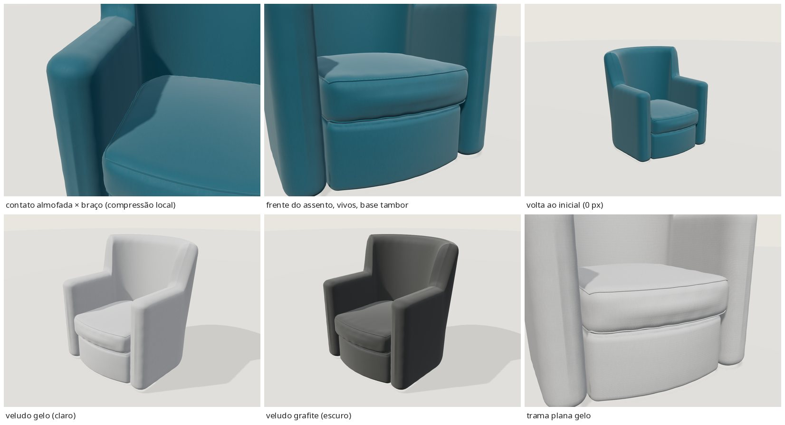

# EXT-014 — Poltrona azul com braços (`stanza-armchair-01` 1.0.0)

**Estado:** tecnicamente validado – revisão visual pendente · prévia `/explorar-sofa.html?modelo=stanza-armchair-01` · produto `/modelos/poltrona-bracos.html` ("Ver em 3D").

## Relação

- Foto: [`poltronas/poltronas-11.jpg`](../../poltronas/poltronas-11.jpg) (1040×780, um ângulo).
- Catálogo `poltrona-bracos` ("Poltrona com braços", `source` = esta foto) e portfólio `projeto-24` ("Poltronas azuis e puff capitonê", mesma foto). Conferido em `data/catalog.json` e `data/portfolio.json`; nenhuma entrada nova, IDs preservados.
- A foto mostra **duas** poltronas idênticas e um puff capitonê. Modelada **uma** poltrona (a da esquerda, mais próxima). O puff é o **EXT-034** (pendente, fora do escopo). Sala, tapete e demais objetos não foram modelados.

## Regiões

| Região | Malhas / material | Observação |
|---|---|---|
| corpo (`body`) | `shell`, `drum_base`, `seat_cushion` → `fabric_main`; vivos `seat_cushion_welt_top/bottom` → `fabric_seam` | Concha contínua (braços + encosto curvo até o piso), base tambor e almofada de assento funcional: tudo no mesmo veludo, muda junto |
| decoração fixa | — | Nenhuma almofada solta na poltrona |
| contraste fixo | — | Sem vivo, tacha ou botão de outra cor (os vivos do assento são do próprio tecido) |
| estrutura aparente | — | Estofada até o piso; nenhum pé, madeira ou metal visível. A base giratória, se existir, fica oculta e não foi inventada |

## Forma e estimativas

Poltrona tipo concha (*tub*): uma única peça estofada (`RoundedBox` deformado ao longo de uma planta em U, com a traseira em meia-elipse) vai da frente do braço direito, contorna o encosto e chega à frente do braço esquerdo. Frentes de braço planas e verticais, topos rolados, encosto alto e largo que sobe com degrau curto atrás dos braços e inclina 5°. Entre os braços: almofada solta com frente convexa e vivos em cima e embaixo, sobre a base tambor recuada de frente convexa.

Câmera ajustada a 12 correspondências (braços, cantos do encosto, frente do assento), foco de 760 px fixo, rolagem 0, rms ~11 px; escala dada pelo **assento a 0,44 m (premissa)**. O preset `photo` é essa câmera reapontada para o centro da poltrona (rotação + zoom no centro óptico); para comparar, a foto é reprojetada pela mesma homografia (faixa preta = fora da foto).

| Medida (estimada) | Valor |
|---|---|
| largura × altura × profundidade (caixa do GLB) | 0,98 × 1,05 × 0,97 m (0,92 nos braços; profundidade 0,84 no piso + inclinação do encosto + frente convexa) |
| braço / encosto | 0,72 m / 1,04 m (o ajuste deu ~0,77 / ~1,1; adotados valores um pouco menores) |
| assento / almofada / topo da base | 0,44 / 0,17 / 0,27 m |
| espessura da concha | 0,155 m |

## Opções

Corpo: tecidos `velvet` (inicial), `linen`, `boucle`, `sarja` × cores `petroleo` (inicial, **nova**), `grafite`, `gelo`, `areia`, `oliva`, `terracota`.

- **Família:** veludo (o brilho do pelo nos braços), a família `velvet` existente, reutilizada por referência. Nenhuma família nova.
- **Cor nova `petroleo` (#0e5668, "Azul petróleo"):** nenhuma cor existente é azul (a mais próxima, `grafite` #494b4b, é cinza neutro). Foi acrescentada de forma aditiva em `COLORS` (`sofa-viewer.js`), `contract.json`, `materials.json`/`generate_materials.py` (`TINTS`), rótulos em `data/sofa-pilot.json` e no `input` oculto de `pages/explore.html`.
- **Mapas embutidos:** o `build.py` tinge o mapa do veludo com a tinta da biblioteca. Como o veludo repete a cada 0,14 m e a unidade UV do corpo é de 0,30 m, os mapas são **pré-repetidos 2×2** (0,15 m), o que fica registrado no extra `embeddedTiles`. O teste do contrato passou a aceitar uma repetição inteira com diferença de até 10%; os modelos anteriores continuam com repetição 1, como antes.

## Números

| | Principal | Móvel |
|---|---|---|
| triângulos | 41 776 (≤ 60k) | 16 080 (≤ 25k) |
| bytes | 2 013 968 (≤ 5 MB) | 631 824 |
| sha256 | `9ebac6e7…0011e` | `422b0eed…6a6` |

## Validação (no visualizador real, a partir do build congelado)

- `npm test` 35/35; `build.py` e `check_site.py --production` OK; o produto `/modelos/poltrona-bracos.html` traz "Ver em 3D".
- glTF-Validator: 0 erros, 0 avisos, 0 infos e 0 dicas nos dois GLBs ([validation/ext014/](validation/ext014/)).
- `behaviour.mjs`: 77/77 verificações. Inclui o link de orçamento com `referencia=poltrona-bracos`, a troca rápida, falha seguida de nova tentativa, `dispose`, console 0 e a home sem carregar a coleção.
- Máscaras (`body-colour-mask-check.json`): só existe a região do corpo; as máscaras ficam idênticas em todas as trocas, e a volta ao acabamento inicial dá 0 px (principal e móvel; foto e 3/4).
- Contatos (`contacts-*.json`): almofada × concha com 3,5 mm de compressão compartilhada (pedida). O vivo inferior entra até ~6 mm na linha de contato. A base tambor fica sobreposta à concha até ~16 mm, por dentro e sob a almofada (invisível).

## Avaliação honesta

Na sobreposição, a silhueta coincide com a da foto: largura, altura dos braços e do encosto, frentes planas dos braços, almofada grossa com vivo e base tambor recuada. Dá para reconhecer esta poltrona; não é um sofá encolhido. Diferenças que continuam:

- O encosto da foto tem o topo um pouco mais largo e "abas" levemente viradas para fora.
- O interior do encosto da foto é mais plano; no render, o sombreado forma um leve V na transição para os braços.
- A compressão da almofada contra os braços é sutil.
- O render fica mais claro que a foto, que está subexposta e em contraluz. O matiz petróleo está próximo.

## Limitações

- Um único ângulo; costas e lateral esquerda externa foram inferidas. Todas as medidas são estimadas a partir do assento de 0,44 m.
- A cor `petroleo` e o tecido são estimativas visuais.
- Base giratória não visível, não modelada.
- Validado apenas em navegador headless (SwiftShader).
