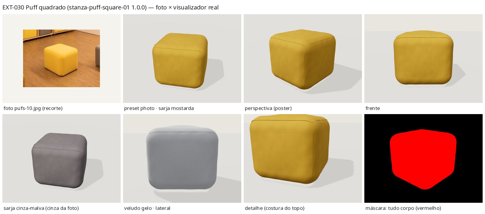

# EXT-030 — Puff quadrado (`stanza-puff-square-01` 1.0.0)

**Estado:** tecnicamente validado – revisão visual pendente · prévia `/explorar-sofa.html?modelo=stanza-puff-square-01` · produto `/modelos/puff-quadrado.html` ("Ver em 3D").

## Relação

- Foto: [`pufs/pufs-10.jpg`](../../pufs/pufs-10.jpg) (1024×683, sala de TV de escritório, luz quente forte).
- Catálogo `puff-quadrado` ("Puff quadrado", `source` = esta foto) e portfólio `projeto-14` ("Puffs para uma sala de TV", mesma foto), conferidos em `data/catalog.json` / `data/portfolio.json`. Nenhuma entrada nova; IDs preservados.
- Modelado **um** puff solto: o amarelo do centro, em primeiro plano. Ficaram de fora os outros puffs, o banco com nichos, a TV, os quadros, o piso e a sala.

## Regiões

| Região | Malhas / material | Observação |
|---|---|---|
| corpo (`body`) | `puff_cover` → `fabric_main`; `puff_seam_top` → `fabric_seam` | capa inteira + costura discreta do topo, mesmo tecido |
| decoração / contraste / estrutura | — | não há: sem pés, base, vivo de outra cor nem almofadas (grupos `legs`/`cushions` vazios, contrato do visualizador) |

## Forma e estimativas

Um `RoundedBox` com a base plana no piso, arestas muito macias (raio 0,085 m), topo abaulado (+18 mm) e laterais levemente abauladas (+10 mm), além de dobras rasas junto às arestas. A foto não mostra vivo nem pesponto nítido; por isso só há uma costura de fechamento no topo, de 1,6 mm. Uma costura na base foi descartada porque aparecia como uma linha clara rente ao piso.

Medidas: o contorno do puff na foto é ~1:1 (108 × 107 px) e o topo/frente na coluna central dá ~0,5. Isso é compatível com altura ≈ 0,9 × largura vista a ~26° de elevação, que confere com o ângulo. A escala vem de um puff estofado típico de **0,45 m** (premissa; não há medida de oficina).

| Medida (estimada) | Valor |
|---|---|
| caixa do GLB | 0,47 × 0,42 × 0,47 m (largura × altura × profundidade, já com os abaulados) |
| corpo nominal | 0,45 × 0,40 × 0,45 m, planta quadrada |

## Opções

Corpo: tecidos `sarja` (inicial), `linen`, `velvet`, `boucle` × cores `mostarda` (inicial), `cinza-malva`, `grafite`, `gelo`, `areia`, `terracota`.

- **Tecido:** liso, fosco e de trama fechada, então usei a família `sarja` da biblioteca. Nenhuma família nova.
- **Cor nova `mostarda` (#e2aa18, "Amarelo mostarda"), aditiva:** não existia nenhum amarelo. A face frontal, balanceada pelo branco da porta, dá ~#c39a26 a #d2af2d. A tinta foi um pouco saturada para a leitura amarelo-limão da foto. Foi acrescentada a `COLORS` (`sofa-viewer.js`), `contract.json`, `TINTS`/`materials.json` (gera `sarja/embedded/basecolor-mostarda-1024/512.jpg`), ao rótulo em `data/sofa-pilot.json` e ao input oculto em `pages/explore.html`. A regeneração dos materiais é determinística: os outros mapas ficaram byte a byte iguais.
- **Cinza da foto:** sem correção, o puff vizinho aparece marrom (luz quente). Balanceado, dá um cinza quente médio, ~#8f807a, por isso reutilizei `cinza-malva` (#8a8286).

## Câmeras

Os presets vêm de `framedCameras` mais o novo enquadramento automático do visualizador. `photo` é uma **aproximação visual** do ângulo da foto (~12° à direita da frente, ~26° de elevação), aproximada a 1,3 m em vez dos ~3 m da foto. Não é uma câmera ajustada por correspondências.

## Números e validação

| | Principal | Móvel |
|---|---|---|
| triângulos | 24 288 (≤ 60k) | 7 680 (≤ 25k) |
| bytes | 2 059 376 (≤ 5 MB) | 650 528 |
| texturas | sarja mostarda 1024 + normal 1024 + rugosidade 256 | 512 / 512 / 256 |

- glTF-Validator: 0 erros, 0 avisos, 0 infos e 0 dicas nos dois GLBs (`validation/ext030/`).
- `behaviour.mjs stanza-puff-square-01`: **80/80** (inclui a regressão do modelo padrão, a página de produto e a home sem a coleção).
- Enquadramento (`framing.mjs`, página real, sem tocar em nenhuma vista): o puff ocupa 0,58 × 0,68 da tela no desktop e 0,68 × 0,68 no celular, centrado. Todos os presets ficam inteiros.
- Máscara de regiões: tudo é corpo, então não há região fixa a conferir.

## Limitações

Um único ângulo: costas e lateral esquerda são inferidas. A escala (0,45 m) é premissa. A cor e o tecido são estimativas sob luz quente. As costuras são só sugeridas. O preset `photo` não é ajustado por correspondências. A validação foi feita só em navegador headless (SwiftShader).
