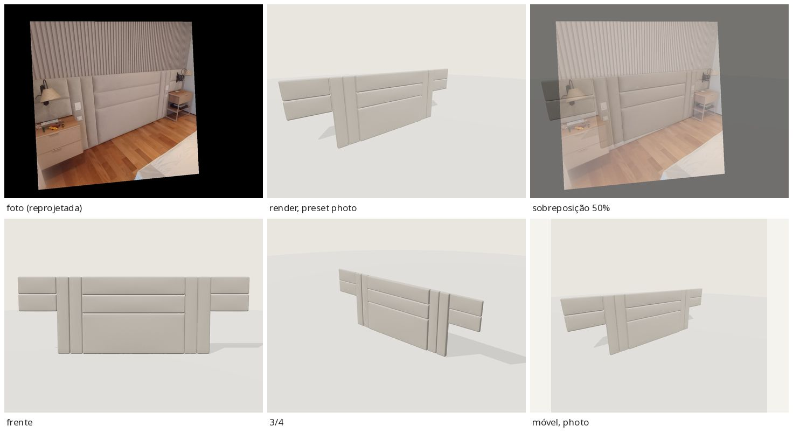
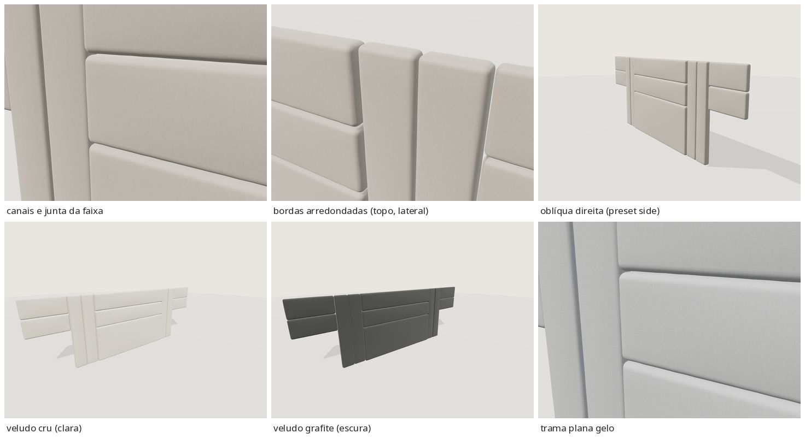

# EXT-040 — Cabeceira de painéis horizontais (`stanza-headboard-panels-01` 1.0.0)

**Estado:** tecnicamente validado – revisão visual pendente · prévia `/explorar-sofa.html?modelo=stanza-headboard-panels-01` · produto `/modelos/cabeceira-paineis.html` ("Ver em 3D").

## Relação

- Foto: [`cabeceiras/cabeceiras-6.jpg`](../../cabeceiras/cabeceiras-6.jpg) (899×899, um único ângulo, quarto em instalação).
- Catálogo `cabeceira-paineis` ("Cabeceira de painéis", `source` = esta foto) e portfólio `projeto-21` ("Cabeceira com painéis horizontais", mesma foto). Conferido em `data/catalog.json` e `data/portfolio.json`. Nenhuma entrada nova; IDs preservados.
- Modelada só a composição estofada fixada na parede. Ficaram de fora os criados-mudos, as luminárias, os interruptores e tomadas, o colchão e a roupa de cama (a cama está afastada e só aparece um canto), o ripado da parede, o piso e a sala.

## Regiões

| Região | Malhas / material | Observação |
|---|---|---|
| corpo (`body`) | 11 painéis → `fabric_main` | Cabeceira central (3 painéis), 4 faixas verticais e 4 painéis laterais, todos no mesmo tecido; mudam juntos |
| decoração fixa | — | não há |
| contraste fixo | — | Sem vivo, friso ou moldura de outra cor. Os canais entre painéis são do próprio tecido |
| estrutura aparente | — | Painéis presos na parede; não aparecem pés, madeira, metal nem suporte |

## Forma e estimativas

São 11 placas estofadas independentes (`RoundedBox`), com o fundo plano no plano da parede, bordas arredondadas, frente levemente abaulada e juntas de 4 mm. Os canais visíveis vêm do arredondado das bordas vizinhas.

Para tirar as medidas, ajustei a câmera e as proporções a 13 correspondências: os cantos da cabeceira central, os dois canais, os topos das faixas e o painel lateral direito. Resultado: rms ~6 px, foco 851 px; a rolagem de 1,2° foi descartada. A escala vem da **largura da cabeceira central fixada em 1,60 m**. É uma premissa: um colchão queen tem 1,58 m, mais 1 cm de cada lado. Como o colchão da foto está afastado, ele não serve de medida direta. O preset `photo` usa a câmera ajustada, reapontada para o centro da composição. Para a comparação, a foto é reprojetada pela mesma homografia.

| Medida (estimada) | Valor |
|---|---|
| composição (caixa do GLB) | 3,60 × 1,21 × 0,10 m |
| cabeceira central | 1,60 m de largura; painéis 0,64 / 0,285 / 0,285 m (ajuste: canais a 0,639 e 0,923 m) |
| altura de tudo acima do piso | 1,21 m (ajuste 1,208) |
| faixas verticais | 2 por lado × 0,20 m (ajuste 0,201), do piso ao topo |
| painéis laterais | 2 por lado × 0,60 m de largura, de 0,67 a 1,21 m; canal a 0,94 m (o ajuste deu 0,926, alinhado ao canal superior central) |
| profundidades | central 0,09 · faixas 0,07 · laterais 0,05 m (lidas pelas faces laterais esquerdas visíveis) |

## Opções

Corpo: tecidos `velvet` (inicial), `linen`, `sarja`, `boucle` × cores `areia` (inicial), `cru`, `gelo`, `grafite`, `oliva`, `terracota`.

- **Família:** o tecido é liso, com brilho suave tipo suede/veludo. Usei a família `velvet` existente, por referência. Nenhuma família nova.
- **Cor:** a média dos painéis, corrigida pelo branco do espelho do interruptor, dá ~#c2b7b3 (greige quente). Reutilizei `areia` (#b6b0a8), a cor existente mais próxima. **Nenhuma cor nova.** Só registrei a tinta `areia` em `materials.json`/`TINTS` (`generate_materials.py`), com o mesmo valor de `COLORS.areia`, para que o mapa embutido passe no teste de contrato (tinta da biblioteca = cor do visualizador). Essa mudança está em um commit separado.
- Mapas embutidos: o veludo é pré-repetido 2×2 (`embeddedTiles`), como no EXT-014.

## Câmeras

O visualizador **não foi alterado**. Os presets automáticos (`framedCameras`) foram pensados para uma peça de assento: `side` olha de lado, rente ao painel, e `front` fica distante. Por isso, a entrada no registro sobrescreve `photo`, `front` (frontal na altura dos olhos), `side` (oblíqua pela direita) e `detail` (closeup dos canais). Isso usa o mecanismo `model.cameras`, que já existia. `threequarter` continua automático.

## Números

| | Principal | Móvel |
|---|---|---|
| triângulos | 42 928 (≤ 60k) | 17 136 (≤ 25k) |
| bytes | 2 087 684 (≤ 5 MB) | 685 856 |
| sha256 | `1d8826ad…ec882` | `a0c172f3…80876` |

## Validação (no visualizador real, a partir do build congelado)

- `npm test` 35/35; `build.py` e `check_site.py --production` OK; o produto `/modelos/cabeceira-paineis.html` traz "Ver em 3D" com link para a prévia.
- glTF-Validator: 0 erros, 0 avisos, 0 infos e 0 dicas nos dois GLBs ([validation/ext040/](validation/ext040/)).
- `behaviour.mjs`: 78/78 verificações. Cobre o orçamento com `referencia=cabeceira-paineis&estudo=stanza-headboard-panels-01`, a troca rápida, falha seguida de nova tentativa, `dispose`, console 0 e a home carregando só `sofa-mobile.glb`. Na mesma rodada, o EXT-001 e as páginas de produto dos demais modelos continuaram passando.
- Máscaras (`body-colour-mask-check.json`): só existe a região do corpo; nenhuma região fixa. A volta ao acabamento inicial dá 0 px (principal e móvel; foto e 3/4).
- Contatos (`contacts-*.json`): nenhuma penetração entre painéis; folgas de 0,6 a 1,0 mm nos pontos mais próximos. Na primeira versão havia 1,3 mm de penetração faixa × central, corrigida com a junta de 4 mm.

## Avaliação honesta

Na sobreposição de 50%, a composição coincide com a foto: cantos e os dois canais da cabeceira central, as quatro faixas, o painel lateral direito e o canal dele. A divisão 0,64 / 0,285 / 0,285 m, as faixas do piso ao topo e os painéis laterais suspensos dão para reconhecer esta cabeceira.

Diferenças que continuam:

- Os canais da foto são linhas mais finas e escuras; no render ficam um pouco mais abertos.
- O abaulamento das frentes é mais uniforme que o da foto.
- O tecido da foto parece um suede mais fosco que o veludo.
- No visualizador não há parede, então os painéis laterais aparecem soltos no ar.

## Limitações

- Um único ângulo. As faces direitas e o topo foram inferidos. Toda a escala depende da premissa de 1,60 m.
- A composição foi tratada como simétrica. O painel lateral esquerdo sai do quadro e a largura de 0,60 m é estimada.
- Recortes de interruptores e tomadas nas faixas não foram modelados.
- `areia` e veludo são estimativas visuais sob luz quente.
- Validado apenas em navegador headless (SwiftShader).
