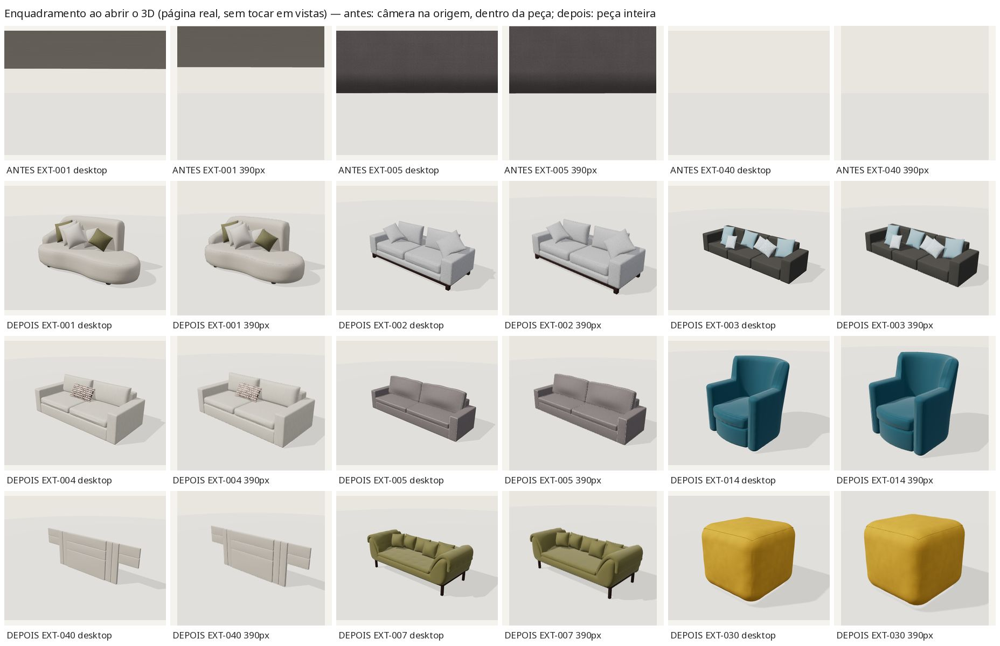

# Enquadramento ao abrir o 3D (correção)

**Relato:** ao clicar em "Ver modelo 3D", a câmera começava no centro do sofá, muito perto, sem mostrar a peça inteira.
**Causa:** `createSofaViewer` não aplicava nenhuma vista inicial. A câmera ficava na origem, dentro do modelo, até que algum botão de vista fosse pressionado.

## O que mudou (`assets/sofa-pilot/viewer/sofa-viewer.js`)

- O visualizador já abre em `options.initialView`, por padrão `threequarter`, logo após o primeiro dimensionamento.
- `fitDistance(min,max,target,position,fov,aspect,margin=.9)` é uma função pura e exportada. Ela calcula a distância em que os 8 cantos da caixa do modelo cabem no quadro, com 10 % de folga, levando em conta a proporção do canvas.
- `setView(id,{fit=true})` recua até essa distância em todas as vistas, exceto `detail` (closeup de propósito). `{fit:false}` aplica o preset sem ajuste.
- Ao redimensionar, a vista atual é reenquadrada até o visitante mover a câmera (arrastar, zoom, girar, setas). A tecla Home e os botões de vista voltam a enquadrar.
- Distância máxima de 9 → 16 m, para peças grandes em telas estreitas.
- As vistas ajustadas à foto (`photo` com `fov`) não alargam mais o campo em canvas estreitos; o ajuste de distância cobre esse caso. Antes, isso deixava a poltrona pequena no celular.
- Home: `setView('threequarter',{fit:false})` mantém o enquadramento próprio do hero, que ficou idêntico, e a home continua carregando só `sofa-mobile.glb`.

## Resultado (página real `explorar-sofa.html[?modelo=…]`, clique em "Explorar em 3D", nenhuma vista tocada)

Fração da tela ocupada pela peça (largura × altura do contorno projetado de todos os vértices; o centro fica a no máximo 0,05 do meio):

| Modelo | Desktop 1440×900 | Celular 390×844 |
|---|---|---|
| EXT-001 stanza-organic-01 | 0,63 × 0,56 | 0,68 × 0,51 |
| EXT-002 stanza-straight-01 | 0,65 × 0,56 | 0,77 × 0,56 |
| EXT-003 stanza-modular-01 | 0,66 × 0,47 | 0,77 × 0,47 |
| EXT-004 stanza-two-seat-01 | 0,68 × 0,57 | 0,80 × 0,56 |
| EXT-005 stanza-piped-01 | 0,65 × 0,53 | 0,76 × 0,53 |
| EXT-014 stanza-armchair-01 | 0,52 × 0,77 | 0,61 × 0,77 |
| EXT-040 stanza-headboard-panels-01 | 0,58 × 0,46 | 0,68 × 0,46 |
| EXT-007 stanza-curved-arm-01 | 0,66 × 0,54 | 0,77 × 0,53 |
| EXT-030 stanza-puff-square-01 | 0,58 × 0,68 | 0,68 × 0,68 |

Antes, a câmera ficava a 0 m do centro em todos os casos (`validation/framing/framing-before.json`).

Os presets `photo`, `threequarter`, `front` e `side` (e `back`, onde existe) também foram medidos nos dois tamanhos (`validation/framing/framing-after.json`): nenhum corta a peça e nenhum a deixa pequena demais. Única observação: na vista `photo` da EXT-040 no desktop, a composição fica deslocada para a esquerda (centro em 0,38), porque reproduz a foto. Isso foi mantido.

Ferramenta: `node scripts/models3d/framing.mjs <out> [--views] [--models a,b] [--viewer <outro módulo>]`. Teste: `tests/viewer-framing.test.mjs`.
